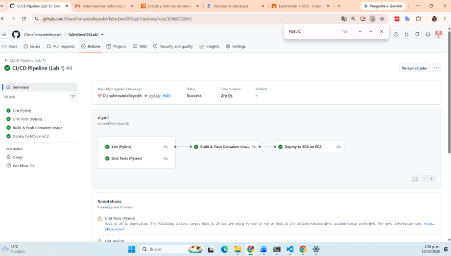
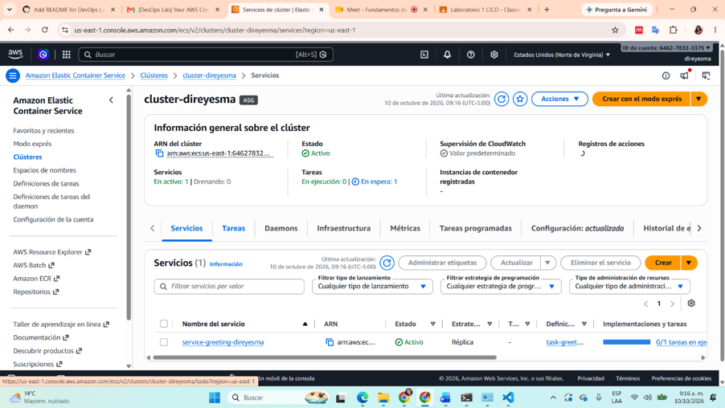
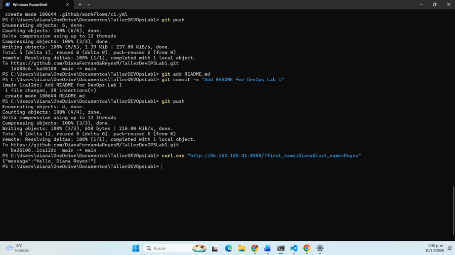
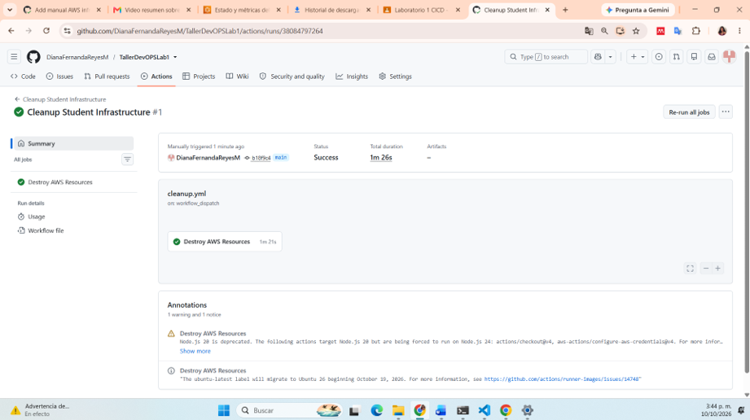

1. Arquitectura de los contenedores.
    La aplicación está desarrollada en Python 3.12 utilizando FastAPI y se ejecuta mediante Uvicorn en el puerto 8000.

    Se implementaron dos endpoints:

        GET /: genera un saludo personalizado a partir de los parámetros first_name y last_name.
        GET /health: proporciona una respuesta para verificar el estado de la aplicación.

2. Componentes de la arquitectura

    *Docker: permite empaquetar la aplicación y sus dependencias en una imagen, facilitando su ejecución en diferentes entornos.
    *GitHub Actions: automatiza la validación del código, las pruebas unitarias, la construcción de la imagen y el despliegue.
    *Amazon ECR: almacena las imágenes Docker generadas por el pipeline.
    *Amazon ECS: administra la ejecución del contenedor y el servicio de la aplicación.
    *Amazon EC2: proporciona la capacidad de cómputo necesaria para ejecutar los contenedores administrados por ECS.
    *Auto Scaling Group: administra la capacidad de instancias EC2 definida para el laboratorio.

2.2. Flujo de despliegue

El proceso comienza cuando se realizan cambios en la rama main del repositorio. GitHub Actions ejecuta las validaciones y, si estas finalizan correctamente, construye una imagen Docker y la publica en Amazon ECR. Posteriormente, el pipeline ejecuta el script deploy.sh, que configura los recursos necesarios en AWS para desplegar la aplicación mediante Amazon ECS sobre una instancia EC2. El contenedor ejecuta FastAPI con Uvicorn y expone el puerto 8000 para recibir peticiones HTTP.

3. Implementación del pipeline CI/CD

Se configuró el archivo .github/workflows/ci.yml, que define cuatro trabajos principales.

        3.1. Lint (Pylint)

        Verifica la calidad del código fuente mediante Pylint, permitiendo identificar problemas de estilo y posibles errores de programación.

        3.2. Unit Tests (Pytest)

        Ejecuta las pruebas unitarias de la aplicación mediante Pytest para verificar el funcionamiento de las funcionalidades implementadas.

        3.3. Build & Push Container Image

        Una vez superadas las etapas de Lint y Test, el pipeline construye la imagen Docker y la publica en el repositorio greeting-direyesma de Amazon ECR.

        La imagen se etiqueta utilizando el identificador del commit y la etiqueta latest.

        3.4. Deploy to ECS on EC2

        El pipeline ejecuta scripts/deploy.sh, que configura la infraestructura requerida y despliega la imagen del contenedor en Amazon ECS utilizando capacidad de cómputo EC2.

        Resultado: Los cuatro trabajos del pipeline finalizaron exitosamente en GitHub Actions.

        3.5. Evidencia del pipeline automático

        

        Figura 1. Ejecución exitosa de los trabajos Lint, Unit Tests, Build & Push y Deploy en GitHub Actions.

4. Verificación de la aplicación desplegada

Se verificó el servicio service-greeting-direyesma dentro del clúster cluster-direyesma, ubicado en la región us-east-1.

Amazon ECS mostró el servicio en estado ACTIVE, con una tarea en ejecución y ninguna tarea pendiente.

4.1. Evidencia del servicio ECS

Figura 2. Servicio Amazon ECS con una tarea en ejecución.

4.2. Prueba HTTP

Se utilizó la IP pública reportada por el script de despliegue para realizar una petición HTTP al endpoint de saludo personalizado.

Método: GET

URL utilizada:

http://54.163.185.41:8000/?first_name=Diana&last_name=Reyes

Comando de prueba:

curl.exe "http://54.163.185.41:8000/?first_name=Diana&last_name=Reyes"

Respuesta esperada:

{
  "message": "Hello, Diana Reyes!"
}

4.3. Evidencia de la petición HTTP

Figura 3. Respuesta del endpoint de saludo personalizado mediante una petición HTTP.

5. Pipeline manual de limpieza de infraestructura

Se implementó el archivo .github/workflows/cleanup.yml para ejecutar manualmente el script scripts/destroy.sh.

A diferencia del pipeline de despliegue, este workflow utiliza workflow_dispatch, por lo que solo se ejecuta bajo demanda.

El identificador STUDENT_SUFFIX permite seleccionar los recursos asociados al estudiante y ejecutar el procedimiento de limpieza.

El script intenta eliminar los recursos utilizados durante el laboratorio, incluyendo el servicio y el clúster ECS, el Auto Scaling Group, la instancia EC2, el Launch Template, el Security Group, los roles IAM correspondientes y el repositorio ECR.

5.1. Evidencia del pipeline manual

Figura 4. Ejecución manual del workflow Cleanup Student Infrastructure.

5.2. Resultados de la limpieza

El workflow finalizó con estado Success en GitHub Actions.

Se verificó que la instancia EC2 quedó en estado Terminated y que el repositorio ECR asociado al estudiante fue eliminado.

Sin embargo, durante la comprobación posterior el clúster ECS continuaba en estado ACTIVE, con un servicio en DRAINING. Por lo tanto, no se confirmó la eliminación completa de todos los recursos.

Este resultado permite identificar la necesidad de mejorar las verificaciones y el manejo de errores del proceso de limpieza.

6. Propuestas de mejora del pipeline

        6.1. Mejorar la detección de errores del proceso de limpieza

        Modificar el script destroy.sh para registrar claramente los errores de AWS y evitar que operaciones fallidas se reporten como exitosas. Implementar verificaciones que confirmen la eliminación de todos los recursos.

        6.2. Incorporar verificaciones posteriores al despliegue

        Agregar una etapa que espere a que el servicio ECS tenga una tarea en estado RUNNING y posteriormente realice una petición HTTP al endpoint /health.

        De esta forma, el pipeline no dependería únicamente de la ejecución exitosa del script para considerar finalizado el despliegue.

        6.3. Mejorar la seguridad de las credenciales

        Utilizar autenticación mediante OpenID Connect (OIDC) entre GitHub Actions y AWS, evitando almacenar credenciales AWS de larga duración como secretos del repositorio.

        Además, limitar los permisos de los roles IAM a las acciones necesarias para cada workflow.

        6.4. Optimizar los tiempos de ejecución

        Implementar mecanismos de caché para las dependencias de Python y las capas de Docker, con el propósito de reducir el tiempo de ejecución y evitar descargas repetitivas.

        6.5. Fortalecer la seguridad del pipeline de limpieza

        Agregar una confirmación explícita antes de eliminar la infraestructura y validar el identificador del estudiante para reducir el riesgo de eliminar recursos equivocados.

        6.6. Controlar el consumo de recursos AWS

        Incorporar etiquetado consistente, alertas de costos y verificaciones de recursos que permanezcan activos después de finalizar el laboratorio.

7. Conclusiones

El laboratorio permitió implementar un flujo CI/CD para una aplicación REST con FastAPI, integrando herramientas de validación, pruebas, contenerización y despliegue en AWS.

La ejecución exitosa de GitHub Actions demostró la automatización de las etapas de validación, construcción y despliegue. Adicionalmente, se comprobó la ejecución del servicio ECS sobre infraestructura EC2.

El proceso de limpieza evidenció la importancia de verificar el estado real de los recursos, ya que una ejecución exitosa del workflow no garantiza necesariamente que todas las operaciones de eliminación hayan finalizado correctamente.

En conjunto, la práctica permitió comprender la relación entre desarrollo de software, automatización de pipelines, infraestructura en la nube y administración del ciclo de vida de los recursos.